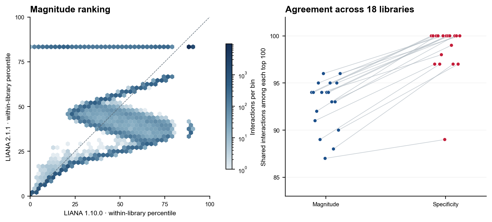
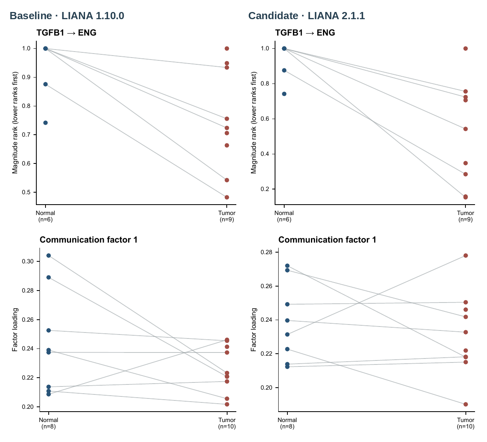
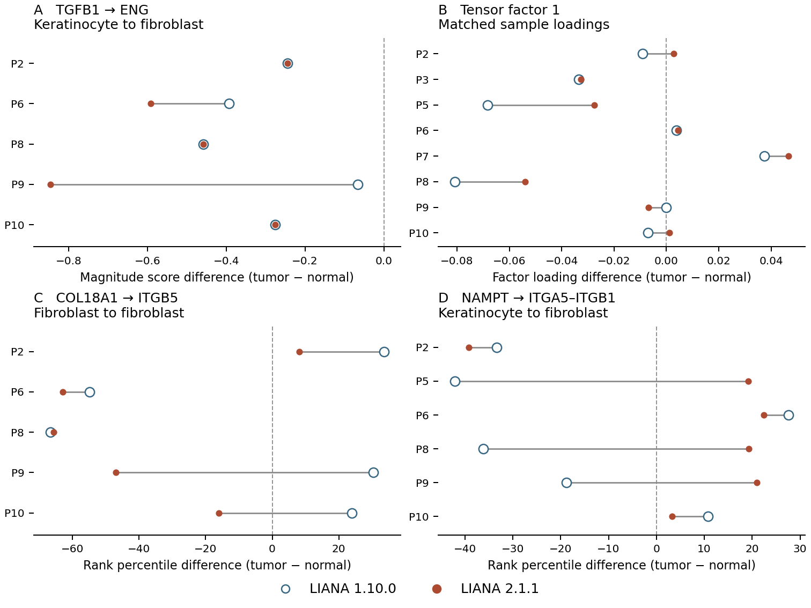
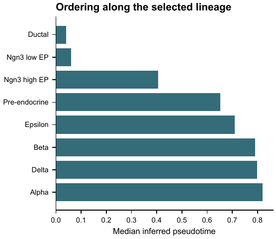
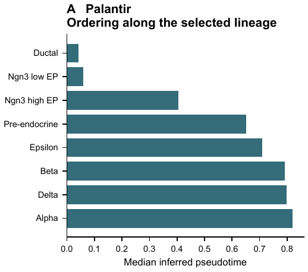
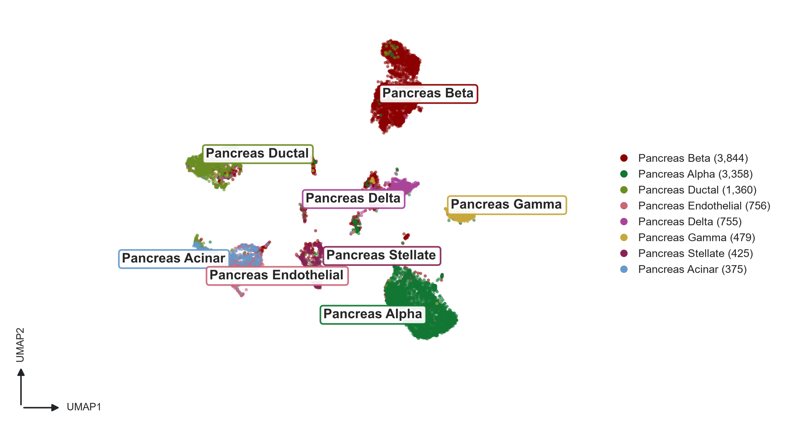

# SCC communication ranking across dependency versions

The public paired squamous-cell carcinoma reference contains 18 libraries. Both environments scored the same 54,450 library-specific sender, receiver, ligand and receptor combinations. The median within-library Spearman correlation for magnitude was 0.666. A median of 94 of each library’s top 100 interactions remained in the top 100 (range 87–96). Specificity ranks were more stable, with a median correlation of 0.998 and median top-100 overlap of 100 (range 89–100).

The left panel includes every matched interaction measurement. A smaller percentile means greater inferred magnitude. Tied scores share their mean percentile. The diagonal marks agreement. On the right, each connected pair represents one library. Sorting tied top-100 scores by sender, receiver, ligand and receptor gives a reproducible cutoff.

## Which dependency changed the rankings?

Each run used the same normalized SCC object, LIANA resource and CellQuorum recipe. Three comparisons independently varied the libraries within the diagnostic environment. The first and last controls preserved every magnitude and specificity score exactly.

| Change | Fixed libraries | Median magnitude ρ | Median shared magnitude top 100 |
|---|---|---:|---:|
| AnnData 0.12.10 → 0.13.4 | pandas 2.3.3, LIANA 1.10.0 | 1.000 | 100 |
| LIANA 1.10.0 → 2.1.1 | pandas 2.3.3, AnnData 0.13.4 | 0.666 | 94 |
| pandas 2.3.3 → 3.1.1 | AnnData 0.13.4, LIANA 2.1.1 | 1.000 | 100 |

The inferred CD8 T cell HMGB1 to keratinocyte SDC1 interaction entered the top 100 in seven libraries with LIANA 2.1.1, up from four with 1.10.0. Across the same 18 libraries, the three optimally matched Tensor-cell2cell sample factors had Pearson correlations of 0.821, 0.973 and 0.958. Matching maximized total sample-loading correlation across factor permutations.

## What changes in the manuscript figures?

These are the rendered CellQuorum manuscript panels. Each line connects measurements from the same patient. The original panels scale their vertical axes independently. Lower LIANA ranks indicate stronger inferred interactions. The candidate report used the same full ligand and receptor complexes for the LIANA, NicheNet and MultiNicheNet panels.

In all five patients with both TGFB1–ENG measurements, the tumor had a lower LIANA rank and a higher MultiNicheNet product than the matched normal sample in both environments. The median paired rank difference changed from −0.276 to −0.457. The expression-based MultiNicheNet products and all six NicheNet target weights were identical. Tensor factor 1 declined in six of eight paired patients on baseline and four of eight on the candidate. These factor loadings support different donor-level interpretations. The three regulatory panel sources matched to floating-point precision.

[Plotted sample measurements](scc-panel-measurements.csv) · [Paired differences](scc-publication-donor-differences.csv) · [Seven-panel source comparison](scc-publication-sources.csv)

## Which SCC conclusions survive the new ranking?

The 18 libraries cover ten patients, eight with both tumor and normal tissue. For each sender, receiver, ligand and receptor combination, we compared the within-library magnitude rank percentile in tumor with the percentile in normal tissue from the same patient. Negative differences mean the interaction ranked higher in tumor. A missing score in either tissue excludes that pair. Of 10,469 distinct combinations, 4,031 had a complete pair and 973 had five or more. Among those 973, **801 kept the direction of their median difference and 172 reversed it** (17.7%).

| Finding | LIANA 1.10.0 | LIANA 2.1.1 | Interpretation |
|---|---:|---:|---|
| Keratinocyte TGFB1 → fibroblast ENG | Tumor ranked higher in 5/5 | 5/5 | MultiNicheNet expression products also favor tumor in the same five pairs. The raw magnitude-score difference grows, while the median within-library advantage shrinks from 32.9 to 24.6 percentile points. |
| Matched Tensor factor 1 | Lower in tumor in 6/8 | 4/8 | The majority decline disappears. P2 and P10 cross zero, both with small loadings. |
| CD8 T-cell HMGB1 → keratinocyte SDC1 | Top 100 in 4 libraries | Top 100 in 7 | P2, P4 and P9 tumor libraries enter the top 100. In both versions only 2/4 complete pairs rank higher in tumor. |
| Fibroblast COL18A1 → fibroblast ITGB5 | Tumor ranked higher in 2/5 | 4/5 | Median tumor minus normal changes from +24.0 to −47.0 percentile points. |
| Keratinocyte NAMPT → fibroblast ITGA5–ITGB1 | Tumor ranked higher in 4/6 | 1/6 | Median difference changes from −26.1 to +19.2 percentile points. |

The last two examples have the largest reversals when sorted by the smaller absolute median difference in the two versions. Neither interaction entered any library’s top 100. Across the 973 comparisons, **none met a 5% false-discovery threshold** in either version (two-sided paired sign test, ties excluded, Benjamini–Hochberg correction applied separately per version). These ranks support prioritizing candidate signals for follow-up. They cannot establish ligand binding or a change in signaling activity.

Each row is one patient. The dashed line marks equal tumor and normal values. Panels A and B use the original quantities plotted in the manuscript panels. Panels C and D use rank percentile points. [Editable donor figure](scc-paired-rank-changes.svg) · [All paired donor differences](scc-paired-rank-donors.csv.gz) · [Interaction summaries and adjusted tests](scc-paired-rank-summary.csv.gz)

## Figure and source data

- [All matched magnitude scores and percentiles (gzip CSV)](scc-magnitude-interactions.csv.gz)
- [Rank correlations, shared top 100 and maximum score changes for each library and control](scc-library-ranks.csv)
- [Paired tensor factor correlations](scc-tensor-alignment.csv)
- [Editable comparison figure](scc-rank-comparison.svg)
- [SCC reference data and recipe](../reference-studies.md)

## Mouse pancreas lineage after the CytoTRACE 2 repair

On the same 3,696 cells and reference recipe, the repaired wheel completed Palantir,
stochastic scVelo, CellRank and CytoTRACE 2. The analysis environment used pandas
3.1.1, AnnData 0.13.4 and NumPy 2.3.5. CytoTRACE 2 used its 19-model ensemble
with pandas 2.3.3 and NumPy 1.26.4 in a separate CPU worker. Both environments
passed `pip check`. The CLI took 3 min 34 s and reached 6.48 GiB peak resident
memory in the Linux/WSL validation run. [Installation instructions](../reference-studies.md#extended-pancreas-lineage-from-a-clean-python-312-install)

| Population | Cells | Median potency |
|---|---:|---:|
| Ductal | 916 | 0.300627 |
| Ngn3 low EP | 262 | 0.196888 |
| Ngn3 high EP | 642 | 0.083378 |
| Pre-endocrine | 592 | 0.070243 |
| Alpha | 481 | 0.081263 |
| Beta | 591 | 0.048151 |
| Delta | 70 | 0.077665 |
| Epsilon | 142 | 0.108630 |

Every potency class agreed with the baseline. The largest absolute change in
any cell's potency score was 4.19 × 10⁻⁹ or less. All six CellRank fate
probability columns agreed exactly after aligning cell and fate identifiers.
The 4,800 fitted values across 24 gene–lineage curves agreed within 10⁻¹⁴.
[Per-cell scores and classes](pancreas/pancreas-potency-by-cell.csv.gz) ·
[Population medians](pancreas/pancreas-potency-by-population.csv) ·
[Numerical and rendered-page comparisons](pancreas/comparison.json)

The two restored publication pages use the same Palantir panel. Their eight
bar lengths reproduce the median pseudotime from the final analysis object.
The largest absolute difference in a plotted median was 2.23 × 10⁻¹⁶.
With Matplotlib 3.11.2 and Pillow 13.0.0, the standalone and assembled pages
differed from baseline in 1.65% and 3.81% of pixels at 150 dpi. Repeating the
full run with the baseline renderer (Matplotlib 3.10.9 and Pillow 12.3.0)
reproduced both pages pixel for pixel and all nine diagnostic PNGs exactly.
The lineage constraints now pin that renderer.
[Diagnostic PNG comparisons](pancreas/diagnostic-pngs.csv)
[Plotted data](pancreas/lineage.palantir.csv) ·
[Standalone PDF](pancreas/lineage.palantir.pdf) · [Standalone SVG](pancreas/lineage.palantir.svg) ·
[Assembled PDF](pancreas/lineage.pdf) · [Assembled SVG](pancreas/lineage.svg)

## GPU workstation validation

A clean install of the Linux GPU lock ran the CellQuorum wheel outside the checkout, with pandas 3.1.1 and AnnData 0.13.4 in the analysis process. The CUDA worker used pandas 3.0.6 with cuDF 26.10.2 and RAPIDS-singlecell 0.18.1. Both environments passed `pip check`. The reference recipe required GPU execution for the routed methods and treated skipped selected analyses as failures.

The input was the public human pancreas reference with 8,391 inDrop cells and 2,961 Smart-seq2 cells, eight published cell types and 1,000 genes. All six selected analysis stages completed and produced the HTML report. The output count layer and cell and gene order matched the input. The graph covered every cell, Leiden produced 17 clusters, and every cell had finite PCA, Harmony, scVI, scANVI and UMAP coordinates.

| Measurement | Earlier reference | New GPU install |
|---|---:|---:|
| Cross-study nearest-neighbor cell-type agreement, PCA | 83.95% | 83.95% |
| Harmony | — | 80.81% |
| scVI | 81.24% | 81.24% |
| scANVI | 89.75% | 89.75% |

For each cell we found its closest cell from the other study and compared the published labels. scANVI used those labels during training, so its agreement measures label preservation. The earlier latent-model recipe omitted Harmony. Stage records identify RAPIDS for PCA, Harmony, neighbors/Leiden and UMAP. Lightning recorded CUDA training for scVI, the scANVI pretraining model and scANVI. Input to report took 2 min 8 s on one RTX 4000 Ada. One-second device-wide samples peaked at 42% utilization and 2,619 MiB used, including other processes. An earlier GPU install gave the same four cross-study agreement values and 18 Leiden clusters. Agreement between the two partitions was 0.932 by adjusted Rand index. The UMAP images differed across the two runs. The final install added the missing LIANA orthology dependency, pooch.

All 34 analysis and five RAPIDS package imports passed in their respective interpreters. A second CLI run on the frozen SCC input recomputed LIANA on CPU in this GPU workstation installation. All 54,450 magnitude scores and all 54,450 specificity scores matched the candidate SCC analysis exactly across all 18 libraries. [SCC rerun evidence](gpu/scc-rank-verification.json)

[Editable figure](gpu/categorical_umap_cell_type.pdf) · [Same coordinates by study](gpu/categorical_umap_study.png) · [Per-cell coordinates, cell type, study and Leiden cluster](gpu/pancreas-umap-source.csv.gz) · [Validated versions, checks and measurements](gpu/validation.json) · [Portable run configuration](gpu/pancreas-gpu.yml)

To reproduce the comparison, follow the GPU installation in `envs/README.md`. Place the [prepared pancreas reference](../reference-studies.md) and the provided YAML in the same directory, then run `cellquorum run -c pancreas-gpu.yml` there. From the repository, run `python scripts/verify_reference_study.py /path/to/runs/pancreas-gpu --data /path/to/input` for the cross-study check.

## CPU workstation validation

A fresh Linux CPU installation ran the published inDrop and Smart-seq2 human
pancreas counts through preprocessing, feature selection, PCA, Harmony, Leiden,
the integration benchmark and UMAP. On 4,500 cells sampled from the 11,352-cell
cohort, Harmony increased iLISI from 0.005 to 0.334. Label agreement (NMI) was
0.737 before Harmony and 0.738 after it. Graph connectivity was 0.987 in both
embeddings. With pandas 3, scib-metrics 0.5.9 failed to compute that metric.
Version 0.5.10 produced all 18 scores.

A second run stopped after preprocessing and requested a restart at clustering.
It restored preprocessing and replayed feature selection, PCA and Harmony.
The counts, normalized expression, coordinates, Leiden assignments and all 18
scores matched the clean run exactly. All nine PNG panels had identical pixels.

A repeat benchmark on the same final object reused the original measurements.
Permuting the published cell-type labels with seed 65 caused a fresh calculation
and reduced Harmony NMI to 0.007. In a separate CPU LIANA run on the frozen SCC
analysis object, all 54,450 rows across 18 libraries matched the candidate
release in magnitude and specificity rank.

To reproduce the checkpoint comparison, place the prepared human pancreas
input and the [CPU study configuration](cpu/pancreas-cpu.yml) in the same directory
and run these commands from that directory.

~~~bash
cellquorum run -c pancreas-cpu.yml -o runs/clean
cellquorum run -c pancreas-cpu.yml -o runs/resumed --until-stage preprocessing
cellquorum run -c pancreas-cpu.yml -o runs/resumed --from-stage clustering
~~~

The [measurements and file hashes](cpu/validation.json) include pixel comparisons
for every panel, the maximum difference for each embedding, input and lock hashes,
the SCC rank comparison, and the benchmark fingerprints before and after shuffling.
