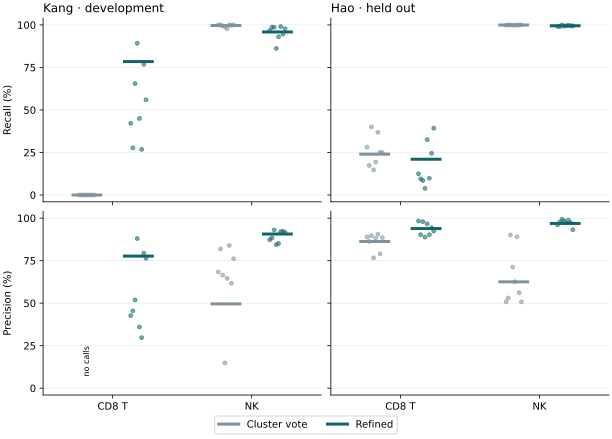
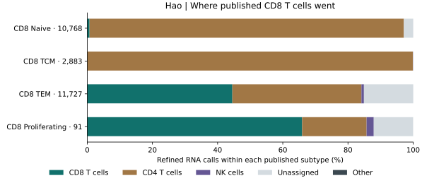

# Blinded human PBMC identity benchmark

CellQuorum recovered CD8 T cells on the Kang development cohort. On the held-out Hao cohort the same rule missed most CD8 T cells. The human PBMC refinement remains opt-in. These results do not support using its CD4 and CD8 fractions for primary abundance comparisons in an independent study.



Each point is one donor. Each horizontal bar is the pooled result. The original vote and the refined call share the same cells and graph within each run. Recall includes every retained cell with the published identity, including abstentions. Precision uses all cells with the predicted identity. No precision estimate is available for the Kang baseline CD8 call because it made zero calls. [Figure source data](pbmc-identity/identity_metrics.csv)

| Study | Population | Correct cluster votes | Correct refined calls | Precision before → after |
|---|---|---:|---:|---:|
| Kang | CD8 T | 0 / 1,621 | 1,272 / 1,621 | — → 77.7% |
| Kang | NK | 1,710 / 1,716 | 1,645 / 1,716 | 49.6% → 90.6% |
| Hao | CD8 T | 6,112 / 25,469 | 5,356 / 25,469 | 86.2% → 93.9% |
| Hao | NK | 18,653 / 18,664 | 18,573 / 18,664 | 62.5% → 96.9% |

Hao passed the prespecified descriptive NK recall tolerance of two percentage points and failed the CD8 recovery endpoint. The refinement gained 4,302 previously missed CD8 T cells and lost 5,058 previously correct calls. Six of eight donors had lower CD8 recall. Classified as CD4 were 17,929 of the published CD8 T cells, including 10,386 naive cells and 2,880 central-memory cells. Only 75 of 10,768 naive CD8 cells and zero of 2,883 central-memory CD8 cells were correctly recovered. These are pooled results for this donor cohort. [Paired transitions by donor](pbmc-identity/paired_transitions.csv) · [Published subtypes by final call](pbmc-identity/hao_subtypes_by_call.csv)



TCM denotes central memory and TEM denotes effector memory. [Subtype figure source](pbmc-identity/hao_cd8_fates.csv)

The run report lists 3,206 of 161,764 Hao cells as Unassigned. There were 1,444 with T-lineage evidence but unresolved CD4/CD8 evidence, 1,377 with weak or conflicting T and innate evidence, and 385 in clusters without a significant panel. This includes 2,087 published CD8 T cells and 41 published NK cells. The per-cell table links each barcode to its cluster vote, final call, reason and local marker scores. The scores are expression summaries. The uncertainty count misses systematic CD8-to-CD4 errors. [Donor uncertainty counts](pbmc-identity/hao_uncertainty.csv)

## Installed-package repeat

With the same counts, recipe and frozen annotation rule, the installed wheel completed all nine stages using the repository's CI constraints (Scanpy 1.12.5, AnnData 0.12.10). The first run used the existing study environment (Scanpy 1.11.5, AnnData 0.12.19). Across all 161,764 cells the two final RNA calls agreed for 99.1%. CD8 recall was 5,351 / 25,469 (21.0%) and NK recall was 18,571 / 18,664 (99.5%) on the installed repeat. The original cluster vote recovered 15.0% of CD8 cells in that environment, versus 24.0% in the first run. The relative improvement therefore changes sign across environments, while the refined rule misses roughly four out of five CD8 cells in both. [Installed-repeat source counts](pbmc-identity/installed_hao_metrics.csv)

## Independent readout from measured proteins

The classifier saw RNA only. After predictions were saved, each ADT marker was normalized to 10,000 total antibody counts per cell, log1p-transformed and fitted with two Gaussian components per sequencing lane. Gates used a posterior of at least 0.90 for each required component. Among 26,545 CD3-1-high, CD8a-high cells, the refined RNA call recovered 5,194 (19.6%). Among 6,486 CD3-1-low, CD56-1-high, CD14-low, CD19-low cells, it recovered 6,175 (95.2%) as NK. Cells outside these gates contribute to the published-label evaluation. The gates and the published multimodal labels share the same biological specimens. [Gated cell counts by donor](pbmc-identity/hao_protein_gated_metrics.csv)

## Reproduce the benchmark

Use the paired-study input described in the [Kang guide](../guide/paired-study.md). For Hao use the full three-prime RNA deposit GSM5008737, ADT deposit GSM5008738 and matched three-prime metadata. The five-prime libraries are a separate experiment. Starting from all 161,764 deposited barcodes yielded 1,294,701,789 UMIs. Per-barcode totals matched the published RNA totals exactly. The blind H5AD contains gene expression counts and donor, day, batch, lane and sample identifiers. The input has no reference labels, embeddings, protein measurements or fitted model. [GSE164378 source files](https://ftp.ncbi.nlm.nih.gov/geo/series/GSE164nnn/GSE164378/suppl/) · [Hao multimodal reference](https://satijalab.org/seurat/articles/multimodal_reference_mapping.html)

From the directory containing the sibling study folders, set `recipes` to the installed `share/cellquorum/workflows` directory. Place the Kang input at `kang/data/kang_2018.h5ad`. The preparation step allowlists columns from GEO metadata. The evaluator joins labels and proteins by barcode only after both prediction files exist.

```bash
mkdir -p hao/source hao/blind hao/evaluation
geo=https://ftp.ncbi.nlm.nih.gov/geo/series/GSE164nnn/GSE164378/suppl
(cd hao/source && curl -fLO "$geo/GSE164378_RAW.tar" && curl -fLO "$geo/GSE164378_sc.meta.data_3P.csv.gz" && tar -xf GSE164378_RAW.tar --wildcards '*3P*')
python "$recipes/helpers/prepare_hao_blind.py" hao/source hao/blind/hao_counts.h5ad
(cd kang && cellquorum run -c "$recipes/kang_pbmc_identity.yaml")
(cd hao && cellquorum run -c "$recipes/hao_pbmc_identity.yaml")
python "$recipes/helpers/evaluate_pbmc_identity.py" . hao/evaluation
```

The nine selected stages cover QC, normalization, highly variable genes, PCA, clustering, annotation, population identity, marker plots and embeddings. Both runs completed all nine. Kang retained 24,562 of 24,673 cells and Hao retained all 161,764. The full Hao CLI run took 10 min 46 s and peaked at 26.7 GiB resident memory on this CPU host. The evaluator writes an HTML comparison, editable figures, two confusion matrices per study, donor metrics, QC retention, and the per-cell evaluation. The pre-unblinding run report remains at `hao/runs/hao_pbmc_identity/reports/report.html`.
