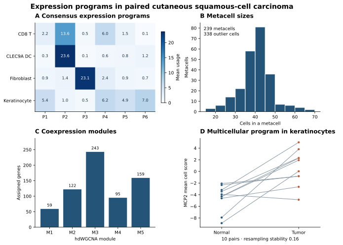

# Public-study evidence

The public-study catalog contains 41 stages and 82 method registrations. Every entry has an on-disk execution record and a scientific or numerical check. The latest review examined the remaining 14 stages and 46 methods individually. Of those 60 checks, 44 supported the stated criterion, 12 gave limited support and four contradicted it. A stage and one of its methods can refer to the same finding. [Scientific validation report](scientific-validation.md) · [All 60 verdicts](scientific-validation.csv) · [Full coverage matrix](study-coverage.csv)

| Study and recipe | Evidence from the reference runs |
|---|---|
| Paired SCC, `scc_paired_signaling.yaml` | Four communication methods plus CollecTRI and pySCENIC. Five eligible paired patients for fibroblast–keratinocyte MultiNicheNet, 18 LIANA libraries, ten patients in CollecTRI and 1,000 cells scored with AUCell. The verifier compares source values, donor support and the published MMP1 and CD63 results. [Reproduce the run](../guide/scc-study.md) |
| Paired PBMC, `kang_paired_analysis.yaml` | Eight donor pairs and eight populations for abundance. All six eligible populations positively enriched the interferon-alpha response at adjusted P < 0.05. The new report includes leave-one-donor-out abundance effects and ranks. [Inputs and design](../guide/paired-study.md) |
| Matched cells and nuclei, `gse140819_tutorial.yaml` | Four matched donors. The input and retained cell totals reconcile. The paired Wilcoxon test for removal fractions yielded P = 1.0. The complete null comparison remains available. [GSE140819](gse140819.md) |
| Pancreas transfer, `pancreas_transfer.yaml` | An 8,391-cell inDrop reference predicted labels for 2,961 held-out Smart-seq2 cells. Truth was removed from the query before training. Accuracy was 87.3%, macro recall 82.5%, and endothelial recall 31.3%. Only the two studies with integer-valued input were used. [scArches source](https://docs.scarches.org/en/latest/scvi_surgery_pipeline.html) |
| Pancreas integration, `pancreas_integration.yaml` | Harmony fit 11,352 cells. On the 4,500-cell stratified scIB sample, scaled iLISI increased from 0.005 to 0.330 and label NMI changed from 0.737 to 0.739. The verifier requires finite mixing and label-preservation metrics. |
| Endocrinogenesis, `pancreas_lineage.yaml` and `pancreas_fates.yaml` | DPT and velocity used the original spliced/unspliced layers. DPT ordered 3,694 of 3,696 cells, with the two unreachable cells marked missing. Ductal, Ngn3-high, pre-endocrine and beta medians increased in that order. Palantir recovered one destination. CellRank assigned six terminal states including ductal and progenitor states. This cohort supports the broad ordering more convincingly than the branch identities. [Lineage dataset](https://scvelo.readthedocs.io/en/stable/scvelo.datasets.pancreas.html) |
| K562 Perturb-seq, `k562_gata1.yaml` | The model trained on control cells. Evaluation used 108 GATA1 CRISPRi cells and 444 disjoint batch-matched controls. Across 1,999 genes excluding GATA1, Spearman ρ between predicted network distance and absolute measured effect was 0.125. Measured GATA1 expression decreased by 0.84 log2 units. A smaller network had zero outgoing GATA1 edges and failed to produce a prediction. [Public scPerturb data](https://zenodo.org/records/10044268) |
| PBMC raw droplets, `pbmc_droplets.yaml` | After QC, all 9,193,863 original counts across 1,176 retained cells and 15,230 genes matched the filtered Cell Ranger matrix by barcode and stable gene ID. SoupX estimated 1% contamination and returned 9,101,567 corrected counts. |
| Kang population review, `kang_population_review.yaml` | Of 532 borderline cells, 423 were rescued and 109 remained unresolved. The focused analysis subclustered 2,651 B cells. Seven populations supplied eight donor pairs for module remodeling, while megakaryocytes supplied three. Twelve of the 24 model fits did not converge. Review the convergence and donor-test columns before interpreting any effect. The original run also requested scDiagnostics without usable diagnostic inputs and returned zero metrics. Its diagnostic stage is excluded from coverage. |

[Download the numerical results and measured runtimes](reference-results.json). Both clean SCC runs passed the reference checks and reproduced the source values for all seven panels. Runtime and peak resident memory come from GNU time. Percent CPU is aggregate across threads. Peak GPU memory was not measured.

### Additional public-study runs

| Study | Checked result |
|---|---|
| SCC communication network | Topology and Ricci curvature ran on both the four-population graph and the 2,664-node, 5,703-edge gene-channel graph. Fibroblasts had the largest outgoing score and keratinocytes the largest incoming score. These describe inferred interactions. |
| SCC expression programs | 9,916 cells contributed to six NMF programs, 239 metacells and five non-grey hdWGCNA modules. There were 338 metacell outliers. DIALOGUE scored MCP2 across ten patients. Its mean stability across five resamples was 0.16. |
| Paired Kang sensitivity | The dream model used a donor random intercept. ISG15 increased in all seven populations where it could be tested. CD14 monocytes contributed all eight donors (log₂ fold change 7.53). The exported eligibility table lists which specimens contributed to each fit. Propeller, Milo and scCODA completed. GSVA group means matched the 16 specimen scores, and PROGENy exported donor-level activities. |
| Kang expression and embeddings | The 24,562-cell run selected 1,500 Seurat variable genes, produced PHATE, lineage markers, continuous expression, state and specimen-weighted density panels. Eight paired donors contributed to the density comparison. The upregulated gene list contained 89 Hallmark interferon-alpha-response genes. |
| Two-study pancreas integration | On 11,352 cells, nearest-neighbor label agreement across studies was 83.9% for PCA, 81.2% for scVI and 89.7% for scANVI. scANVI saw labels during fitting. The separate held-out transfer run above evaluates prospective mapping. |
| Mouse endocrine lineage | Palantir, stochastic scVelo, CellRank and CytoTRACE2 completed on 3,696 cells. Median potency estimates were 0.301 in ductal cells, 0.083 in Ngn3-high progenitors and 0.048 in beta cells. The probability vectors summed to one. Outputs include 24 fitted gene-lineage curves with exported numerical coordinates, velocity stream and diagnostics, a pseudotime heatmap and a pathway activity plot. The four-gene reference uses a Gaussian GAM with an identity link for continuous normalized expression. |
| Mouse endocrine perturbation | CellOracle fit cluster-specific networks and predicted knockout shifts for Neurog3 and Pdx1 on the declared 2,000-cell subsample. Mean vector magnitudes recomputed from cell shifts were 0.564 and 0.376, respectively. Experimental perturbation agreement is assessed separately in K562. |

For the two Kang supplements, generate the specimen-labelled input once with `python "$recipes/helpers/prepare_kang_specimens.py" runs/kang_paired_analysis/objects/final_annotated.h5ad kang_sensitivity_input.h5ad`. For SCC, run the paired signaling recipe first. Both network and program recipes use the published four-population slice. After the program run, `python "$recipes/helpers/figure_scc_programs.py" runs/scc_programs` exports the editable four-panel figure, individual source tables and legend in `reports/publication/scc_programs/`.

For the extended lineage recipe, install the `lineage` extra with the shipped `lineage-constraints.txt` into the current analysis environment and provision the CytoTRACE2 models. The reference used scVelo 0.3.4 with NumPy 2.3.5. Install the standard CellOracle environment including loompy and pyarrow for its separate perturbation run. The SCC program run needs memory for both the Python parent and its R worker. In a 10 GiB container two stability resamples exhausted the cgroup limit. The 14 GiB container completed the five resamples. Strict execution treats a killed resample as an incomplete requested analysis. A whole-VM restart interrupts live computation. The file `logs/stage_events.jsonl` records stage boundaries per attempt. Use a persistent output volume and configured checkpoints for resume. In the endocrine reference, resuming at `trajectory_viz` from the saved trajectory checkpoint reproduced the clean run’s potency scores, pseudotimes, fate probabilities and 4,800 fitted curve coordinates exactly.

[Figure legend](scc-programs/legend.txt) · [NMF means](scc-programs/A_nmf.csv) · [Metacell sizes](scc-programs/B_metacell_sizes.csv) · [Module sizes](scc-programs/C_module_sizes.csv) · [Paired donor scores](scc-programs/D_donor_scores.csv)

## Reproduce and inspect

The installed `share/cellquorum/workflows` directory contains recipes and preparation helpers. Prepare each study in its own working directory and run `cellquorum plan -c "$recipes/NAME.yaml"` followed by `cellquorum run -c "$recipes/NAME.yaml"`. For each completed run, use `python "$recipes/helpers/verify_reference_study.py" RUN_DIRECTORY --data STUDY_DIRECTORY`. The resulting `reports/reference_validation.json` records the measured values. Each run also has a resolved configuration, per-stage records, warnings, an artifact manifest and the final analysis object.

- For the atlas obtain the `pancreas.h5ad` file linked in the [scArches tutorial](https://docs.scarches.org/en/latest/scvi_surgery_pipeline.html). Run `python "$recipes/helpers/prepare_pancreas_atlas.py" pancreas.h5ad .` to write the training and query matrices, held-out labels and the separate integration input. The transfer recipe used CUDA for scVI/scANVI and query mapping. Integration used scib-metrics 0.5.9, chex 0.1.90, plottable 0.1.5 and the CPU backend for JAX.
- For lineage download the [scVelo pancreas object](https://scvelo.readthedocs.io/en/stable/scvelo.datasets.pancreas.html) and name it `endocrinogenesis.h5ad`. Reference SHA256 is `9e3e459eca00ba06b496ec80def32941b5b2889918720e3e7aa6ffb811fbe7c6`. Use scVelo for velocity and Palantir and CellRank for the fate recipe.
- For perturbation download `ReplogleWeissman2022_K562_essential.h5ad` from the linked scPerturb record. Run `python "$recipes/helpers/prepare_perturbseq.py" ReplogleWeissman2022_K562_essential.h5ad .`. Set `CELLQUORUM_KNK_PYTHON` to the full path of the Python interpreter in the [isolated scTenifoldKnk environment](../sctenifoldknk.md). When the variable is unset, the planner probes the current interpreter for scTenifoldpy. The verification script exports aligned predicted and measured gene-level effects.

For SoupX, download the [1k PBMC v3 raw and filtered 10x matrices](https://www.10xgenomics.com/datasets/1-k-pbm-cs-from-a-healthy-donor-v-3-chemistry-3-standard-3-0-0). Put the two H5s in `pbmc_1k_v3/outs` with their standard Cell Ranger filenames. The SHA256s are `ed17bec5896a8208acfd6202e035fc36c65da14b3605aa577e93496b5d1ebd81` for raw and `8191f576550c1b449d03441b9eb098ee9f73fa82513d171ba87d31d551e3ffda` for filtered. Create `libraries.csv` with columns `sample_id,path,cellranger_path` and one row with `pbmc_1k_v3` in each column. Run `cellquorum import-counts libraries.csv input.h5ad`, then run the PBMC droplets recipe from the same directory.

The [scientific validation report](scientific-validation.md) provides the commands to regenerate the per-method verdicts and rebuild the complete matrix. Both the verdicts and the matrix ship in the wheel.

## Handoff to another laboratory

An independent wet-lab handoff is outstanding. Give the researcher the [quickstart](../guide/tutorial.md) and a new study with a sample sheet. Record the package version, the exact command, required outside assistance and their answers to the following tasks.

1. Set up and run the study without editing Python or R.
2. Identify one completed analysis and explain one omitted or ineligible analysis from the plan or report.
3. Pick a result and name the contributing biological replicates and comparison.
4. Retrieve its editable panel, exact source table, legend and resolved settings. Check one plotted value against the table.

A maintainer or automated fixture can verify the files and numbers. Record completion of the human handoff only after an independent researcher performs those tasks.
