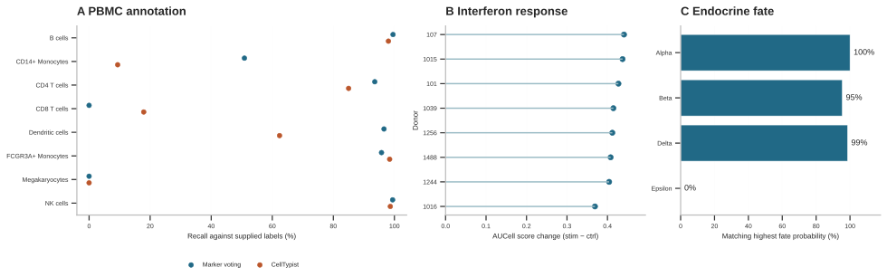

# What the public studies support

This review covers the 14 stages and 46 methods that previously had execution evidence alone. Each row has a stated criterion, a measured comparison, a verdict, the exact run and the artifacts inspected. Stage and method rows overlap. A plotted quantity can pass a fidelity check even when the cohort provides little evidence for a biological mechanism. [All 60 verdicts](scientific-validation.csv) · [Full catalog](study-coverage.csv)

| Scope | Supported on this study | Limited | Contradicted by the study or artifact |
|---|---:|---:|---:|
| Stages | 11 | 2 | 1 |
| Methods | 33 | 10 | 3 |



Panel A shows recall within each supplied PBMC label. CellTypist fine labels were mapped to the eight published labels where their meanings matched. Intermediate macrophage and mast-cell calls have no unique matching label and count as mismatches. Panel B shows the stimulated minus control difference in mean interferon AUCell score for each donor. Panel C shows the fraction of already differentiated cells whose observed identity received the highest fate probability. The benchmark has no experimentally tracked future fates.

### Paired interferon response

In the Kang cohort, all three scoring methods recovered the expected response in **all eight donor pairs**. Median stimulated-minus-control changes were +0.413 AUCell, +0.455 UCell and +1.492 for Scanpy score_genes, each in its own units. All six populations entering the Hallmark GSEA comparison had positive IFN-alpha enrichment at adjusted P < 0.05. All 20 exported running enrichment curves reconstructed to within 2.6 × 10⁻¹³. The normalized count layer also agreed with the public source for all 24,562 retained cells. [Kang et al.](https://pubmed.ncbi.nlm.nih.gov/29227470/)

The eight population volcano plots reproduced their discovery counts from donor-aware edgeR tables. The pooled volcano reproduced 804 upregulated and 386 downregulated genes at the thresholds printed on the panel. The marker dot plots reproduced 192 means and 192 detection fractions per method. Cell-type, donor and condition counts reconciled in all 128 composition strata. [Measured comparisons and underlying filenames](scientific-validation.csv)

### Annotation, clustering and abundance

Marker voting recovered 99.5% of supplied B cells and 0% of CD8 T cells. CellTypist recovered 98.0% and 17.9%, respectively, under the label mapping above. Overall agreement was 78.6% for marker voting and 65.4% for CellTypist. The independently checked passthrough matched all 24,562 public labels. The Kang downstream comparisons used the supplied labels. PAGA used marker-vote labels and consequently lacks a CD8 T-cell node.

Leiden clusters had 92.6% majority-label purity, but 15 of 18 clusters contained over 90% cells from a single treatment arm. Each B-cell subcluster contained cells from all eight donors, and the most condition-restricted subcluster came 99.4% from one arm. These results support stimulation-associated structure. Stable new cell types would require additional evidence. Both PCA and UMAP achieved 96.0% accuracy when retrieving a label from another donor on the jointly fitted embedding. Megakaryocyte recall was 27.3% in PCA and 0% in UMAP. Only 22 megakaryocytes were available.

scCODA called six credible effects using NK cells as reference and two under automatic reference selection. None of the eight population-level donor sign tests passed FDR 0.05. Milo identified 1,781 of 1,794 neighborhoods at spatial FDR < 0.05. Independently, 97.9% of nearby cells in PCA came from the same treatment arm. Broad-population Propeller found zero of eight changes at FDR < 0.05. A neighborhood shift in this experiment can reflect the strong expression response within a cell population. The saved Milo outputs lack the donor memberships needed to verify every neighborhood independently. [Abundance and annotation checks](scientific-validation.csv)

### Pancreatic development, feature selection and ambient RNA

DPT medians increased from ductal to Ngn3-high to pre-endocrine to beta cells. Velocity assigned 62.3% of normalized cross-stage edge weight to the expected forward direction. Alpha, beta and delta cells received their matching highest CellRank fate in 100%, 95.4% and 98.6% of cases. The model omitted epsilon and called two ductal states and an Ngn3-high progenitor state terminal. Hormone-marker ranks among inferred drivers were 1 for Sst, 7 for Gcg and 52 for Ins1 within their respective lineages. This supports several endocrine identities and a broad ordering. Driver causality and individual progenitor destinations remain unresolved with a single embryonic snapshot. [Reference lineage and four expected fates](https://scvelo.readthedocs.io/en/stable/scvelo.datasets.pancreas.html)

The ten pathway–pseudotime correlations printed on the cascade figure matched an independent calculation from expression and mouse Hallmark gene sets within 0.0046. The original gene heatmap correctly located Neurog3, Ins1, Gcg and Sst in their expected populations, but mislabeled equal-cell-count bins as percentages of elapsed pseudotime range. The first quartile occurs at 16.2% of that range. The renderer now labels the percentile within condition and identifies the score track. The verifier writes a corrected PDF beside the review and preserves the original failed verdict.

On the two-study atlas, independent Pearson residual variances reproduced all 800 selected genes. All four assayed control markers were retained, but 800 of the 1,000 input genes were selected, giving marker-enrichment P = 0.409. This checks the implementation and leaves the biological selection advantage unresolved. On the PBMC droplet study, SoupX removed 92,296 UMIs. Across 10,429 genes, the removal fraction correlated only weakly with ambient-to-cellular enrichment (Spearman ρ = 0.211). No molecule-level truth distinguishes legitimate expression from contamination here. [Public 10x PBMC reference](https://www.10xgenomics.com/datasets/1-k-pbm-cs-from-a-healthy-donor-v-3-chemistry-3-standard-3-0-0)

### Carcinoma communication

In paired SCC, both sender TGFB1 and receiver ENG were detectable in the specified cell types in all ten eligible samples from five patients. Four receiver CD63 values agreed with the published example within 0.183 log units. The top NicheNet ligand, TGFB1, was detectable in 28.1% of 7,528 keratinocytes. Both MultiNicheNet group PDFs contained the expected top-30 pair labels, and all 20 top NicheNet ligand names appeared in their activity panel. All five LIANA/network panels reproduced from source tables within the stated rendering tolerance. Fibroblast-to-keratinocyte had the highest pooled weight and ranked first in 12 of 18 libraries. These are expression and prioritization results. Establishing active signaling requires an independent measurement. [MultiNicheNet paired SCC reference](https://github.com/saeyslab/multinichenetr/blob/main/vignettes/paired_analysis_SCC.knit.md)

The subsequent [blinded human PBMC identity benchmark](pbmc-identity.md) evaluates the optional cell-level refinement on Kang and Hao, including protein evidence, abstentions and donor-level changes.

### Reproduce the checks

From the directory containing the public-study folders, run the following in the CellQuorum science environment with NumPy, SciPy, pandas, anndata, scikit-learn, matplotlib, Pillow and Poppler's `pdftotext` available. The reference used matplotlib 3.11.1 and pycirclize for the chord figure. A renderer or font change can change the pixel comparison. The numerical checks and the render difference are reported separately in the row results.

```bash
recipes="$(python -c 'import sysconfig; print(sysconfig.get_path("data"))')/share/cellquorum"
python "$recipes/workflows/helpers/validate_study_results.py" \
  --data . --coverage "$recipes/benchmarks/study-coverage.csv" --output scientific-validation
python "$recipes/workflows/helpers/study_coverage.py" \
  --scientific-review scientific-validation/scientific-validation.csv \
  --output scientific-validation/study-coverage.csv --require-complete \
  scc/runs/{scc_release,scc_network_gene_channels,scc_programs_14g} \
  kang/runs/{kang_paired_analysis,kang_population_review,kang_sensitivity_docker,kang_expression_verified} \
  nuclei/run pbmc_droplets/runs/pbmc_droplets_repaired perturbation/runs/k562_gata1_default \
  pancreas/runs/{pancreas_transfer_diagnostics,pancreas_splice,pancreas_fates,pancreas_integration_full,pancreas_latent_sensitivity,pancreas_celloracle,pancreas_lineage_report}
```

Open `scientific-validation/index.html` for the study-local review. Its links open the exact scientific tables, original figures, input objects and corrected heatmap. The review also exports both annotation confusion matrices, all eight donors’ interferon contrasts, endocrine fate agreement, the cascade correlations and checksums of the study inputs. The coverage builder verifies the source inputs, stage receipts and inspected artifact bytes before attaching a verdict. `--require-complete` checks that every catalog entry has been reviewed. The verdict column preserves limited and contradicted outcomes.
