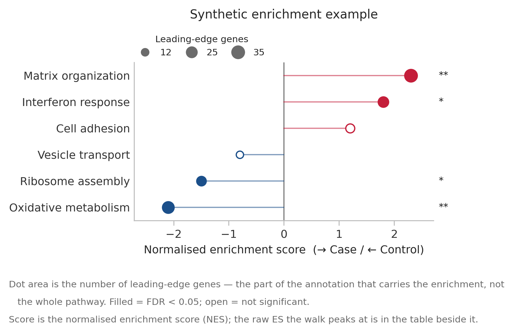
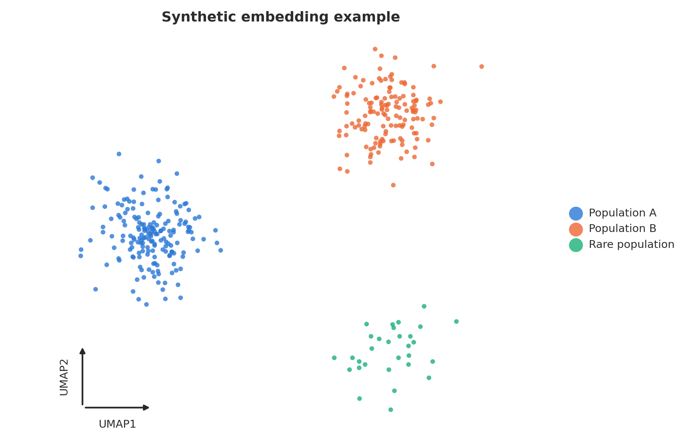
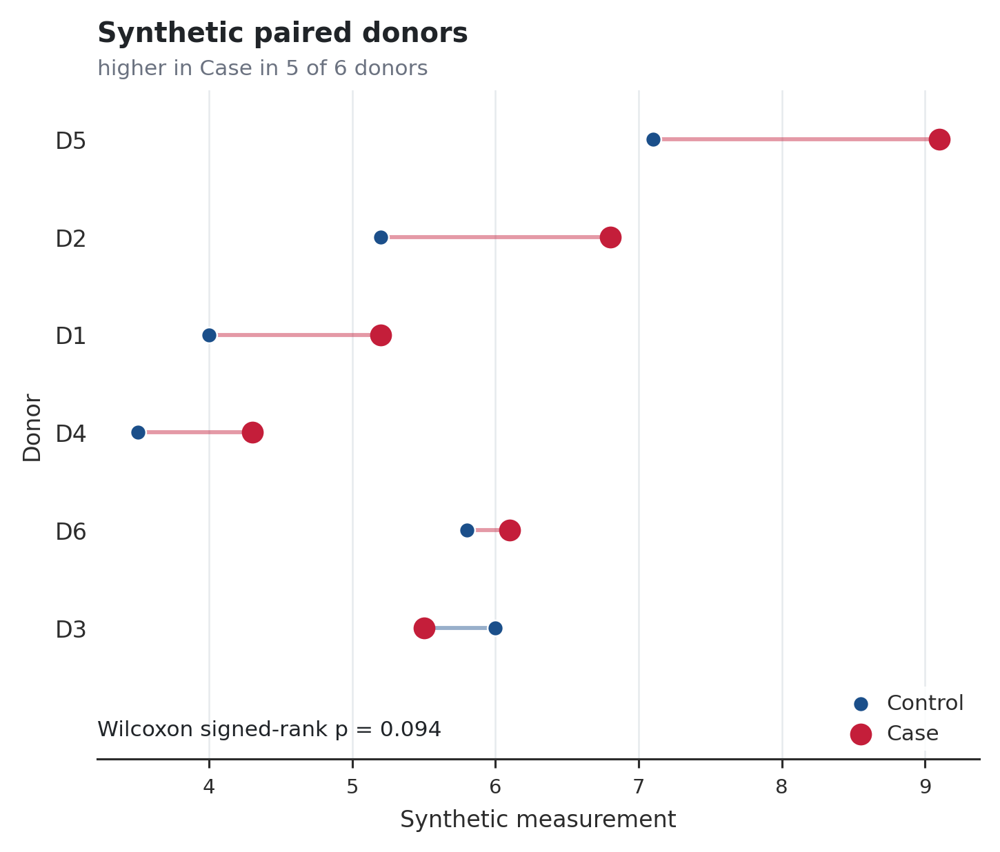
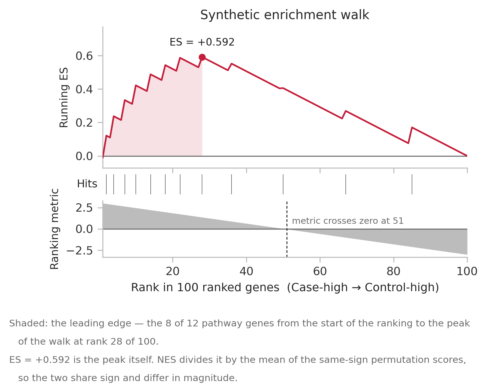
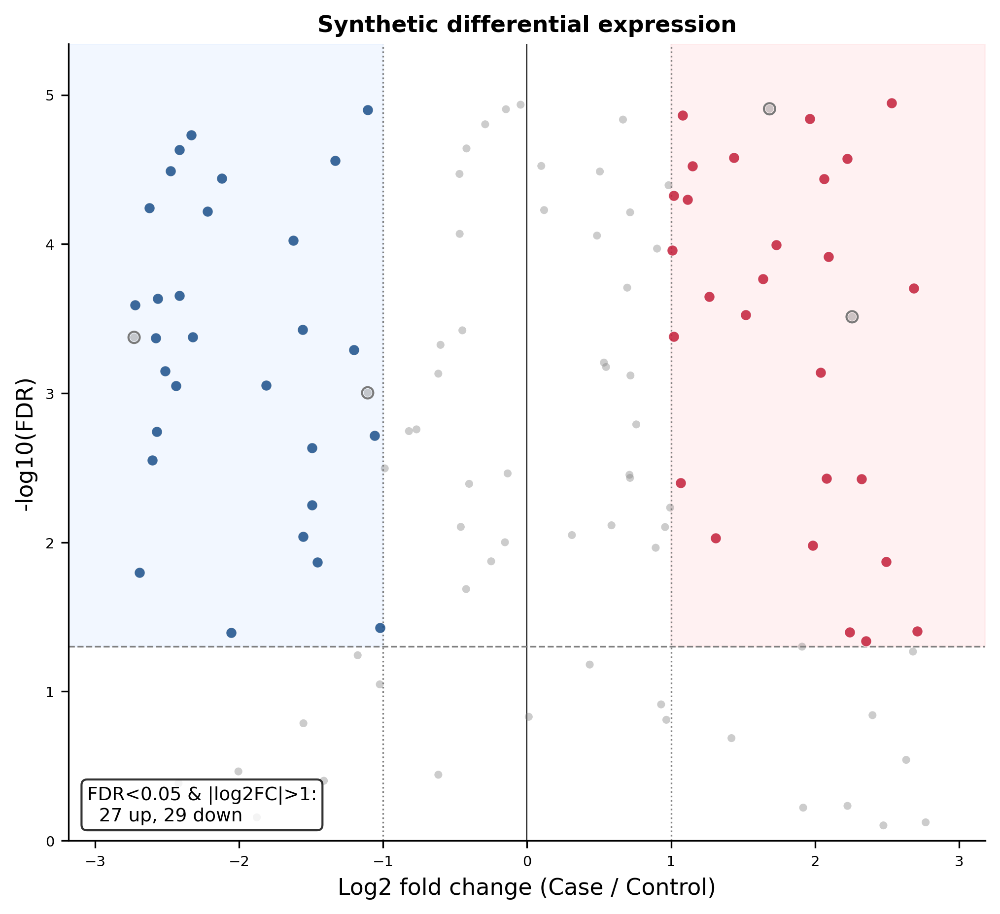
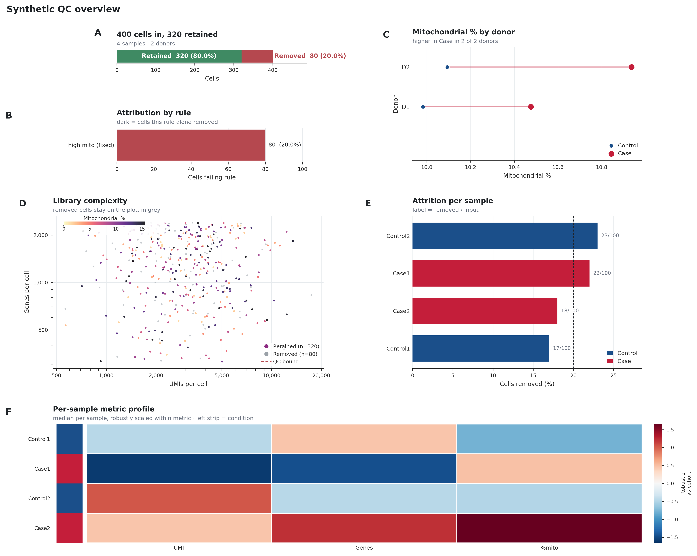

# Publication figure gallery

These examples use explicitly synthetic results to demonstrate the package's
existing renderers. They are not biological findings or validation benchmarks.

## Enrichment



[Source table](assets/enrichment_source.csv) · [PDF](assets/enrichment.pdf) ·
[Editable SVG](assets/enrichment.svg)

Positive scores point toward Case; negative scores toward Control. Dot area
encodes leading-edge size, and filled points indicate FDR below 0.05. The source
values are fixed so changes to the rendering can be reviewed against the same
input. Statistical values are supplied to the renderer, not inferred from the
figure.

## Categorical embedding



[Coordinates and population labels](assets/embedding_source.csv) ·
[PDF](assets/embedding.pdf) · [Editable SVG](assets/embedding.svg)

The example contains 180, 140, and 30 points in three populations. Coordinates are
generated directly with a fixed seed, not computed by UMAP. The smaller population
tests its visibility in the renderer; it does not validate rare-cell detection or
QC retention. The same plotting function renders real analysis embeddings.

## Paired donors



[Source measurements](assets/paired_source.csv) ·
[Computed comparison](assets/paired_comparison.json) ·
[PDF](assets/paired.pdf) · [Editable SVG](assets/paired.svg)

Each line connects the same donor's Control and Case measurements. Five of six
donors increase in this synthetic fixture; one decreases. The paired Wilcoxon
result is computed by the statistics module and passed to the renderer. Its
donor identities, effect, counts, and p-value are saved independently in JSON.

## GSEA running score



[Ranking, hits, and running score](assets/running_score_source.csv) ·
[PDF](assets/running_score.pdf) · [Editable SVG](assets/running_score.svg)

This synthetic weighted walk uses 12 hits among 100 ranked entries. Hit increments
sum to one and miss decrements sum to minus one; generation checks that the walk
returns to zero. The peak occurs at rank 28 with eight leading-edge hits. No
permutation test is performed, so no NES or significance estimate is supplied.

## Volcano



[Synthetic effects and adjusted p-values](assets/volcano_source.csv) ·
[PDF](assets/volcano.pdf) · [Editable SVG](assets/volcano.svg)

Red and blue highlight positive and negative effects passing both displayed
thresholds. Outlined gray points carry the synthetic `likely_ambient` flag and
are excluded from the highlighted up/down counts. These flags and adjusted
p-values are fixture inputs, not results of ambient correction or model fitting.
Gene labels are disabled in this overview; label-placement tests remain separate.

## QC summary



[Per-cell metrics, decisions, and rule flags](assets/qc_summary_source.csv) ·
[PDF](assets/qc_summary.pdf) · [Editable SVG](assets/qc_summary.svg)

The fixture has 400 cells in four samples from two donors. A deliberately simple
synthetic mitochondrial-percentage rule retains 320 cells and removes 80. This
rule exists only to demonstrate reporting and is not a recommended QC policy.
The figure displays attrition, rule attribution, paired donor measurements,
library complexity, and sample profiles. No inferential donor comparison is
supplied for this two-donor example.

Regenerate from the repository root with:

```bash
python scripts/build_figure_gallery.py
```

The generator requires every requested format to be saved and fails if a renderer
reports an error. `tests/test_figure_gallery.py` regenerates all six examples,
checks the 18 exports, verifies SVG text remains editable, and checks source-data
counts, pairing effects, rule flags, and the running-score endpoint. These tests
run as part of the normal suite. A separate CI job installs the reference renderer
constraints and enables exact PNG comparisons against the visually inspected
gallery images. Reproduce that check with:

```bash
pip install -e '.[dev]' -c envs/figure-constraints.txt
CELLQUORUM_CHECK_FIGURE_BASELINES=1 pytest tests/test_figure_gallery.py
```

The reference rendering uses Matplotlib's bundled DejaVu Sans fallback, with no
Arial or Helvetica installed. The constraints pin Matplotlib, NumPy, and Pillow;
they are not a full environment lock. Intentional appearance changes require
regenerating and visually reviewing the references. CI retains failed comparison
artifacts for inspection. All six initial examples are present; this
gallery does not yet establish visual equivalence to the original reference
figures or robust layout across arbitrary datasets.
